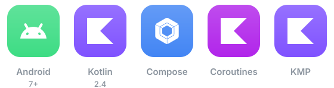
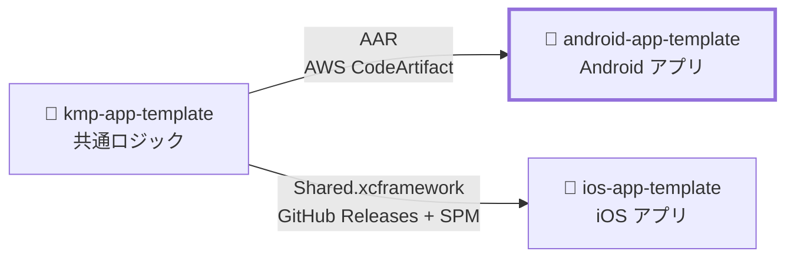
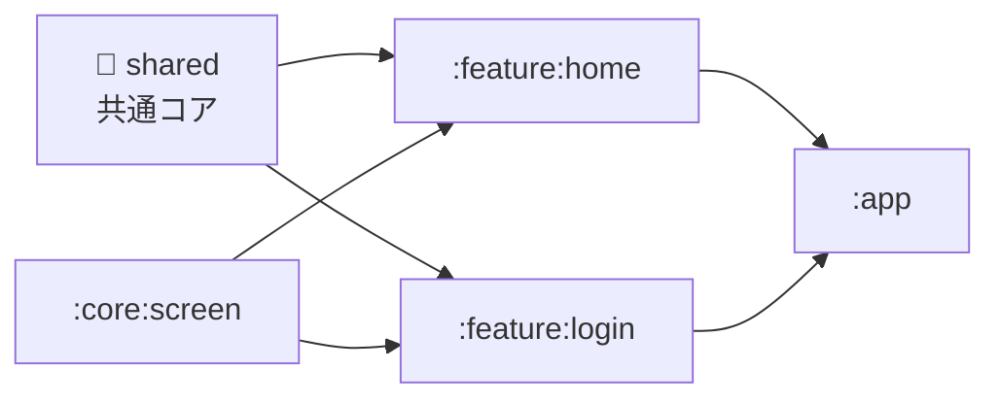

# 🤖 android-app-template

Jetpack Compose と Kotlin Multiplatform で作る、商品一覧アプリのテンプレート



## ✨ 機能

| 商品の一覧（ライト） | 商品の一覧（ダーク） |
| --- | --- |
|  |  |

| 機能 | 内容 |
| --- | --- |
| ログイン | DummyJSON にログインする |
| 無限スクロール | 一覧を下へ進むと続きを読み込む |
| 絞り込み | 商品名で絞り込む |

## 🗺️ 全体像



[🧩 kmp-app-template](https://github.com/yossibank/kmp-app-template) ・ [🍎 ios-app-template](https://github.com/yossibank/ios-app-template)

### モジュール構成



| モジュール | 役割 |
| --- | --- |
| `:core:screen` | 画面の土台（読み込み状態の管理）と、機能に依らない UI 部品 |
| `:feature:home` | 一覧の画面 |
| `:feature:login` | ログインの画面 |
| `:app` | 共通コアの設定と、ログイン状態に応じた画面の切り替え |

## 💻 実行環境

| 項目 | 内容 |
| --- | --- |
| 対応 OS | Android 7+（minSdk 24） |
| 言語 | Kotlin 2.4 |
| ビルド | Gradle 9.8.2、Android Gradle Plugin 9.4.1 |
| 共通コア | Kotlin Multiplatform（AWS CodeArtifact から取得） |
| lint | ktlint |

[手順とコマンド](docs/development.md)

## 🚀 入れ方

```sh
# テンプレートから作ったとき：GitHub のオーナーとパッケージの接頭辞を置き換える
# 3 つのリポジトリそれぞれで実行する
scripts/rename.sh <GitHub のオーナー> <パッケージの接頭辞>    # 例: scripts/rename.sh acme com.acme

# 共通コアを手元のものに差し替える：kmp-app-template のディレクトリを絶対パスで渡す
# このときトークンは要らない
SHARED_DIR=/path/to/kmp-app-template make verify
```

```properties
# Android Studio で差し替えるときは、~/.gradle/gradle.properties に書く
shared.dir=/path/to/kmp-app-template
```

## 📚 文書

| 文書 | 内容 |
| --- | --- |
| [docs/development.md](docs/development.md) | 動かし方と、共通コアを取得するトークン |
