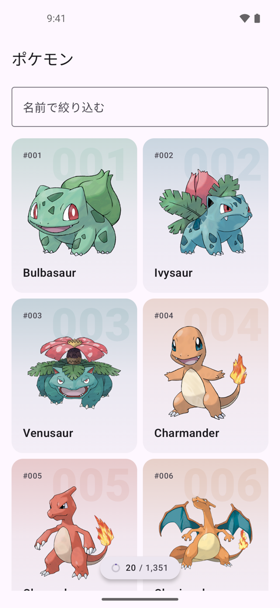
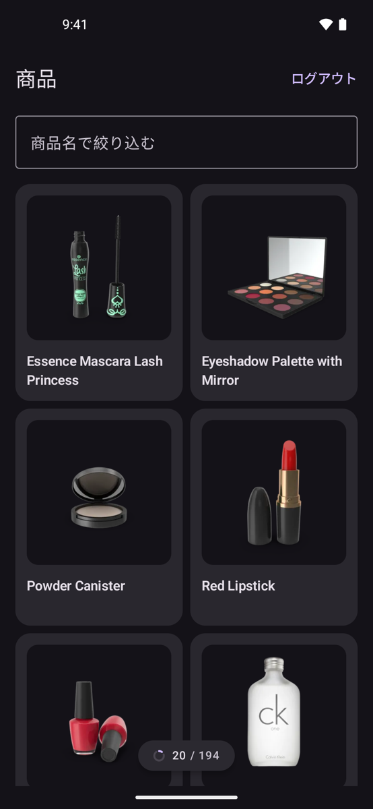
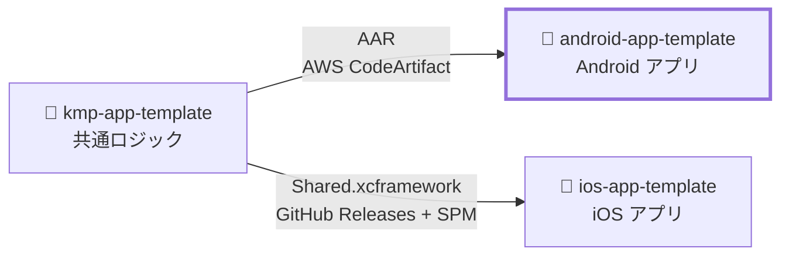
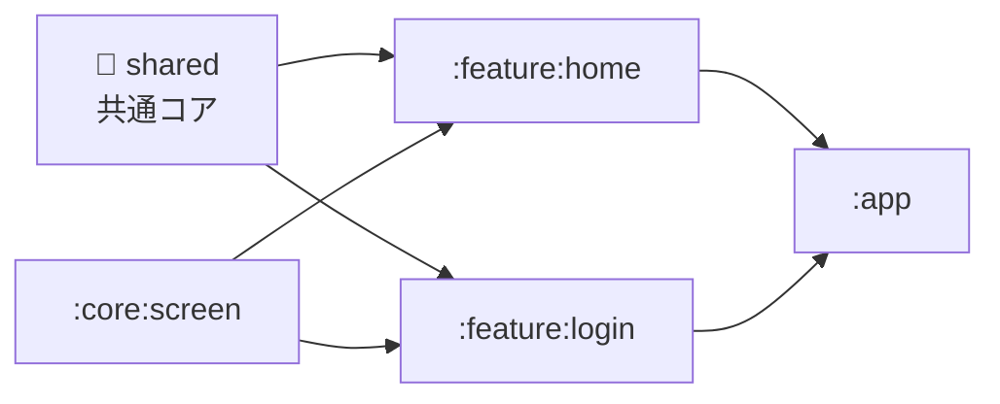

# 🤖 android-app-template

Jetpack Compose と Kotlin Multiplatform で作る、商品一覧アプリのテンプレート

[](https://github.com/yossibank/android-app-template/actions/workflows/verify.yml)
[](LICENSE)


<table>
  <tr>
    <th>ライト</th>
    <th>ダーク</th>
  </tr>
  <tr>
    <td></td>
    <td></td>
  </tr>
</table>

DummyJSON にログイン ・ 無限スクロール ・ 商品名で絞り込み

## 3 つのリポジトリ



[🧩 kmp-app-template](https://github.com/yossibank/kmp-app-template) ・ [🍎 ios-app-template](https://github.com/yossibank/ios-app-template)

## モジュール構成



| モジュール | 役割 |
| --- | --- |
| `:core:screen` | 画面の土台（読み込み状態の管理）と、機能に依らない UI 部品 |
| `:feature:home` | 一覧の画面 |
| `:feature:login` | ログインの画面 |
| `:app` | 共通コアの設定と、ログイン状態に応じた画面の切り替え |

## 動かし方

最初に、次の順にコマンドを実行する。

| 順 | コマンド | 内容 |
| --- | --- | --- |
| 1 | `make token` | 共通コアを取得するトークンを `~/.gradle/gradle.properties` に書き込む（12 時間有効、Android Studio も使う） |
| 2 | `make build` | ビルドする（Android Studio で開いてもよい） |
| 3 | `make verify` | 変更したら通す |

> [!IMPORTANT]
> 共通コアは AWS CodeArtifact から取得する。`make token` の前に AWS にログインしておく。

### 共通コアを手元のものに差し替える

kmp-app-template のディレクトリを絶対パスで渡す。このときはトークンは要らない。

```sh
SHARED_DIR=/path/to/kmp-app-template make verify
```

Android Studio では `~/.gradle/gradle.properties` に `shared.dir=/path/to/kmp-app-template` を書く。

### テンプレートから作ったとき

パッケージの接頭辞と GitHub のオーナーを置き換える。3 つのリポジトリそれぞれで実行する。

```sh
scripts/rename.sh <GitHub のオーナー> <パッケージの接頭辞>    # 例: scripts/rename.sh acme com.acme
```

